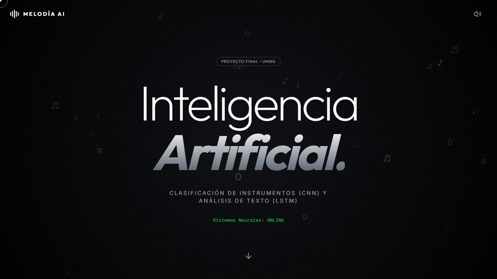

# Melodía AI

Aplicación web que ejecuta dos redes neuronales directamente en el navegador con TensorFlow.js:

- **Clasificación de instrumentos (CNN):** a partir de una imagen reconoce acordeón, batería, piano, violín o flauta.
- **Detección de humor (LSTM):** clasifica un texto en inglés como gracioso o no gracioso.

**[Ver la demo en vivo](https://theser19.github.io/ProyectoFinalAA/)**



Proyecto final de la materia **Aprendizaje Automático**, Ingeniería en Multimedia, Universidad Militar Nueva Granada (UMNG).

## Modelos

| | CNN (imágenes) | LSTM (texto) |
| :--- | :--- | :--- |
| Entrada | Imagen de 150×150 px | Texto de hasta 50 tokens, vocabulario de 10.000 palabras |
| Arquitectura | 4 capas convolucionales (32, 64, 128, 128 filtros), MaxPooling, Dense 512, Dropout 0.5 | Embedding (dim 64), LSTM (64 unidades), Dropout 0.3 |
| Optimizador | SGD (lr = 0.01) | Adam (lr = 0.001) |
| Resultado | ~70 % de precisión en validación (un SVM con PCA llegó al 98 % en la comparación) | 93,9 % de precisión, F1 = 0,94 |
| Datos | 5 clases de instrumentos | ~200.000 textos balanceados |

Los modelos se entrenaron con TensorFlow/Keras en Google Colab y se exportaron a formato TensorFlow.js. La página también muestra las gráficas de entrenamiento, la matriz de confusión del LSTM y la comparación RNN vs LSTM.

## Tecnologías

TensorFlow.js · Keras · Tailwind CSS · HTML/JavaScript · GitHub Pages

## Estructura

```
index.html          Interfaz y lógica de inferencia
Modelo_Imagenes/    Modelo CNN exportado a TensorFlow.js
modelo_texto_web/   Modelo LSTM, tokenizer y configuración
assets/             Gráficas de entrenamiento y captura
```

## Ejecutarlo en local

Los modelos se cargan con `fetch`, así que la página necesita un servidor (no funciona abriendo el archivo directamente):

```bash
python -m http.server 8000
```

Luego abre `http://localhost:8000`.

## Equipo

- Jose Luis Pineda Barrera ([@Jlpineda12](https://github.com/Jlpineda12))
- Sergio Cárdenas Perdomo ([@Theser19](https://github.com/Theser19))
- Juan Sebastián Rodríguez ([@Sebbzz](https://github.com/Sebbzz))
